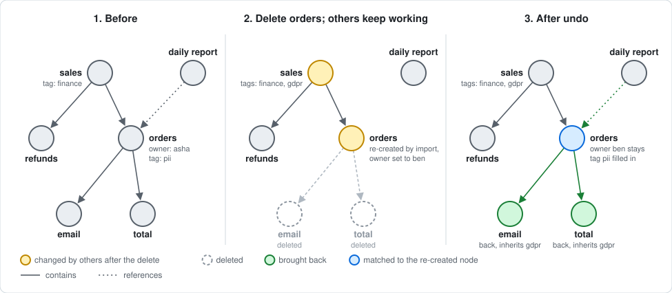
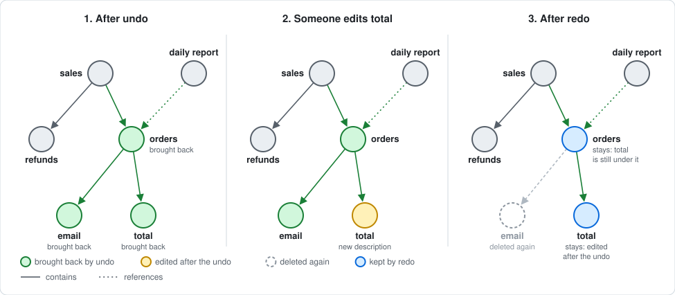

# Undo in a shared graph

A command-line tool that stores a graph in one SQLite file and can undo a subtree delete after other
people and an ingest job have kept editing the graph. Redo is built too. The rules are in
[DECISIONS.md](DECISIONS.md), and the full design is in [docs/design.html](docs/design.html) (download it
and open it in a browser). The mistakes the AI model made while designing and building it are listed
in [MODEL_MISTAKES.md](MODEL_MISTAKES.md).

## How undo and redo behave

**Undo** brings back what the delete removed, without losing anything people did since.



**Redo** deletes again what undo brought back, but keeps anything people worked on after the undo.



More cases, such as a second delete or a person moving a link, are step-through stories in
[docs/design.html](docs/design.html), sections 3 and 4.

## Setup

You need Python 3.11 or newer. There is nothing to install, because the tool uses only the standard
library.

```bash
git clone https://github.com/prtm1908/subgraph-delete-undo.git
cd subgraph-delete-undo
```

## Run it

```bash
python3 gen_fixture.py --seed 7 --out fixture
python3 gen_fixture.py --small --out fixture_small
python3 run_scenario.py --fixture fixture --small fixture_small --out run
python3 checker.py fixture --small fixture_small --run run
```

1. Generates the main fixture. The same seed always gives the same files.
2. Generates the small fixture used by the design's examples.
3. Runs the whole scenario, about 17 seconds, and saves every dump and report under `run/`.
4. Checks the results and prints one PASS or FAIL line per check. It exits with status 0 when every
   check passes.

## Use the tool directly

```bash
python3 graphundo.py load fixture/seed.jsonl
python3 graphundo.py apply fixture/ops.jsonl
python3 graphundo.py undo op0001 > report.json
python3 graphundo.py redo op0001 > redo_report.json
python3 graphundo.py dump > graph.jsonl
```

The database is `graph.db` in the current directory. Use `--db PATH` or set `GRAPHUNDO_DB` to keep it
somewhere else. If you set `CRASH_AFTER=n`, `undo` or `redo` stops after n writes. Run the same command
again to finish the job.

## AI sessions

The AI sessions used to design and build this project are in [AI sessions/](AI%20sessions/), as JSONL
transcripts:

1. `undo-design-transcript.jsonl`: designing undo.
2. `undo-implementation-and-redo-design-transcript.jsonl`: building undo and designing redo.
3. `redo-review-and-fixes-transcript.jsonl`: reviewing the redo design, then building and fixing
   redo.
